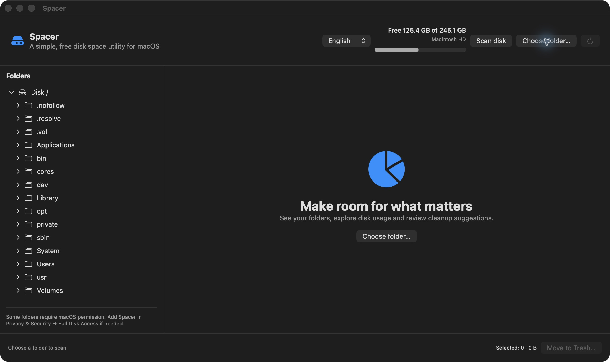

# Spacer

**A simple, free utility for checking disk space on macOS.**

See how much space is free, find what takes up room, and explore your folders with a two-level disk usage chart. Spacer runs locally, has no subscriptions or ads, and never sends your file list to a server.



## Features

- Free space and total capacity for the current volume, refreshed every 30 seconds.
- A folder tree from the disk root, clickable path breadcrumbs, and keyboard navigation.
- Two chart rings: the current folder’s contents and one more level of subfolders.
- Search by name or path, size sorting, and cleanup suggestions with explanations.
- A quick initial folder listing while sizes are calculated in the background.
- Saved scan results for faster navigation during the current session.
- English by default, with Russian available from the language menu.
- Selected items move to macOS Trash only after confirmation. Nothing is automatically deleted.

## Install

Requirements: **macOS 13 or later** and **Apple Command Line Tools with Swift 5.9 or later**. The steps below build an app for your Mac’s architecture; a prebuilt, notarized installer is not currently provided.

1. Download this repository, or clone it:

   ```sh
   git clone https://github.com/cnc-club/MacOS-Spacer.git
   cd MacOS-Spacer
   ```
2. Open Terminal in the project folder. If Command Line Tools are not installed, run `xcode-select --install` and complete Apple's installer.
3. Build the application:

   ```sh
   chmod +x build-app.sh check.sh
   ./build-app.sh
   ```

4. In Finder, open the `dist` folder and drag **Spacer.app** into **Applications**.
5. Open Spacer from Applications, then click **Choose folder…** or **Scan disk**.

The build script signs the app locally. It is not Developer ID signed or notarized; macOS may ask you to approve opening a locally built app. The application and its language resources are contained in `Spacer.app` and do not require the source folder after installation.

To run from source without installing:

```sh
swift run Spacer
```

For a faster development build:

```sh
./build-app.sh debug
```

### Access to protected folders

Some macOS folders require extra permission. If necessary, add **Applications/Spacer.app** in **System Settings → Privacy & Security → Full Disk Access**, then quit and reopen Spacer. macOS may still restrict some system locations. The app does not request an administrator password or change permissions itself. Inaccessible items are counted in the status bar.

## Use

Choose a folder or scan the disk from `/`. The list appears first; unknown sizes show `…` until the scan finishes. You can browse elsewhere while a scan is running: the previous scan is cancelled, and its late results cannot overwrite the new view.

Click a folder in the tree, a breadcrumb, or a chart sector to navigate. Click a file to reveal it in Finder. Click a tree row to focus keyboard navigation:

| Key | Action |
| --- | --- |
| ↑ / ↓ | Move through visible folders |
| → | Expand a branch, or select its first child |
| ← | Collapse a branch, or select its parent if already collapsed |

Choose **English** or **Русский** from the language menu. This changes Spacer's labels, explanations, status messages and size formatting without restarting or losing your current scan. System dialogs, operating-system error messages, disk names and filenames retain their own language.

## Cleanup suggestions and limits

Suggestions are prompts for review, not proof that a file is unnecessary:

- Caches unchanged for more than 30 days: quit the related app before cleanup.
- Logs older than 30 days: they may still help with troubleshooting.
- Old installers and archives in Downloads: check that their contents are installed or saved elsewhere.

The 30-day threshold is a project heuristic, not an Apple rule. A modification date is not a last-used date. Large files, old personal documents, photos and applications are not labelled unnecessary based on size or age alone. Duplicate detection is not implemented.

Deletion is intentionally limited to eligible items inside your home folder. Standard top-level home folders, Library and paths outside home are protected from deletion in this version; they can still be analysed. Spacer does not empty Trash. Moving items to Trash does not free space until you empty it yourself.

Sizes are logical file sizes. APFS clones, hard links, compression, cloud placeholders and snapshots can make actual disk usage or recovered space different. Symlinks are not traversed. App packages and libraries are shown as single objects. A scan from `/` excludes `/dev` and `/System/Volumes` to avoid device traversal and counting the same data volume twice; explicit scans of individual folders are still available. These exclusions and access errors are counted separately.

Background: [Apple storage management](https://support.apple.com/guide/mac-help/change-storage-settings-mchl3d437fbc/mac), [cache directories](https://developer.apple.com/documentation/foundation/using-the-file-system-effectively), and [freeing disk space](https://support.apple.com/en-sg/102624).

## Contributing and localization

Run the scanner checks with `./check.sh`. They use temporary fixtures and never delete your personal files. Tests cover sizes, sorting, cancellation, links, safe paths, fast lookup and free-space reporting. `python3 scripts/check-localizations.py` checks language keys and placeholders.

Translations live in `Sources/Spacer/Resources/<language>.lproj/Localizable.strings`. English phrases are stable keys; use `T("English phrase")` for app-owned UI strings and `%@` placeholders for values. Suggestions store keys, not rendered translations. See [the localization guide](docs/LOCALIZATION.md) to add another language.

## License

Spacer is free and open-source software under the [MIT License](LICENSE). You can use, modify and redistribute it, including commercially, with the required copyright and license notice.
